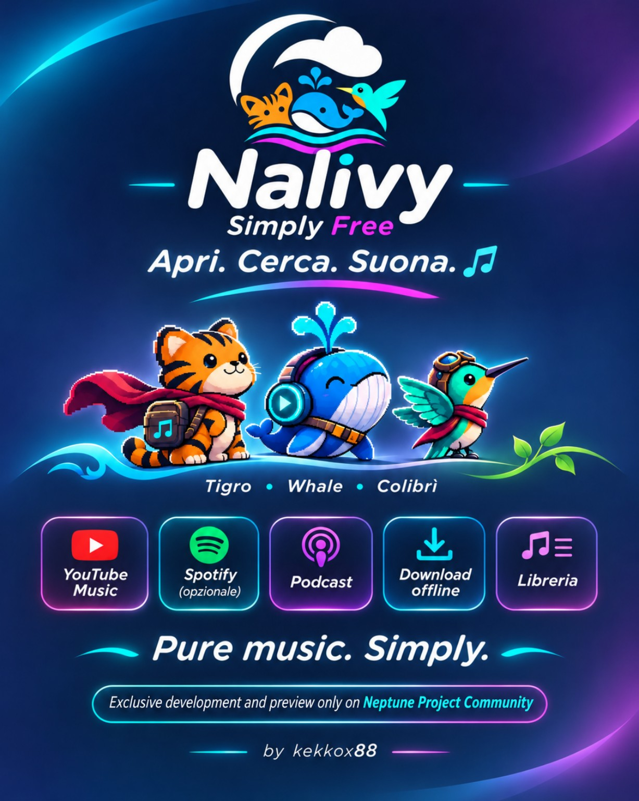

  

<h1 align="center">Nalivy Simply Free</h1>

<strong>Apri. Cerca. Suona.</strong> <em>Pure music. Simply.</em>

  <a href="https://kekkox88.github.io/Nalivy-Downloads/"><strong>🌐 Pagina download</strong></a> ·
  <a href="https://github.com/kekkox88/Nalivy-Downloads/releases/latest"><strong>📦 Ultima release stabile</strong></a> ·
  <a href="https://github.com/kekkox88/Nalivy-Downloads/releases"><strong>📜 Cronologia versioni</strong></a>

---

### La musica, semplicemente

**Nalivy Simply Free** riunisce in un'unica esperienza Android musica, podcast, libreria personale e ascolto offline, con un'interfaccia in stile **Nalivy Simply**.

- **YouTube Music** — esplorazione e riproduzione del catalogo pubblico, secondo disponibilità.
- **Spotify opzionale** — accesso alle raccolte e ai metadati personali. **Non è utilizzato il player Spotify**.
- **Podcast** — ricerca, serie ed episodi in un'esperienza dedicata.
- **Download offline** — ascolto dei contenuti effettivamente scaricati.
- **Libreria** — raccolte e preferiti personali.
- **Android Auto** — integrazione multimediale dove supportata e validata per la release.

La disponibilità dei contenuti dipende dalla rete, dalle fonti e dalle condizioni dei rispettivi servizi. Le funzionalità possono variare tra release.

### Download e aggiornamenti

Le **APK approvate** vengono pubblicate esclusivamente nella sezione [Releases](https://github.com/kekkox88/Nalivy-Downloads/releases). La [pagina download](https://kekkox88.github.io/Nalivy-Downloads/) legge automaticamente l'ultima *release stabile* e mostra i file APK effettivamente presenti.

Se non sono presenti release stabili, significa che **non è stata ancora pubblicata una versione scaricabile da questo repository**. Non vengono proposti file fittizi o APK DEV.

Per aggiornare Nalivy senza perdere le configurazioni, utilizzare una APK con **stesso package name, stessa firma e versionCode appropriato**. Evitare di disinstallare l'app per aggiornare. Android richiede che l'utente confermi l'installazione degli APK distribuiti fuori dallo store.

Per ogni release pubblicare note di versione, architettura supportata, SHA-256 e istruzioni per l'aggiornamento.

### I tre Guardiani di Nalivy

Le mascotte ufficiali **Tigro**, **Whale** e **Colibrì** sono presenti nella pagina download con le immagini pixel-art originali fornite dal progetto.

### Sviluppo e community

**Exclusive development and preview only on Neptune Project Community.**

Le build di sviluppo e le anteprime della community sono separate dalle release pubbliche. Questo repository è dedicato alla **distribuzione**, non ai sorgenti di sviluppo, ai dati del Vault o alle credenziali.

### Sorgenti e licenze

Prima di distribuire APK verificare gli obblighi relativi alle licenze dei componenti integrati. Il repository di sviluppo può rimanere privato, ma alcune licenze — incluse GPLv3 e GPL-3.0-or-later — possono richiedere di mettere a disposizione il **codice sorgente corrispondente** delle build distribuite. Vedere [SOURCE-COMPLIANCE.md](SOURCE-COMPLIANCE.md) e [RELEASE-CHECKLIST.md](RELEASE-CHECKLIST.md).

**Nessun APK va pubblicato prima del completamento della verifica delle licenze e dell'approvazione della release.**

---

<strong>Nalivy Simply Free</strong> · <em>Pure music. Simply.</em> by <strong>kekkox88</strong>

